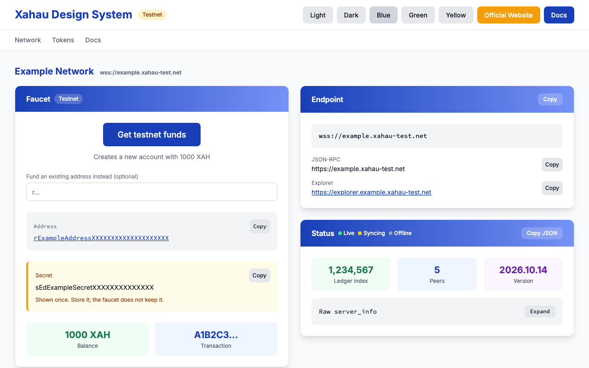
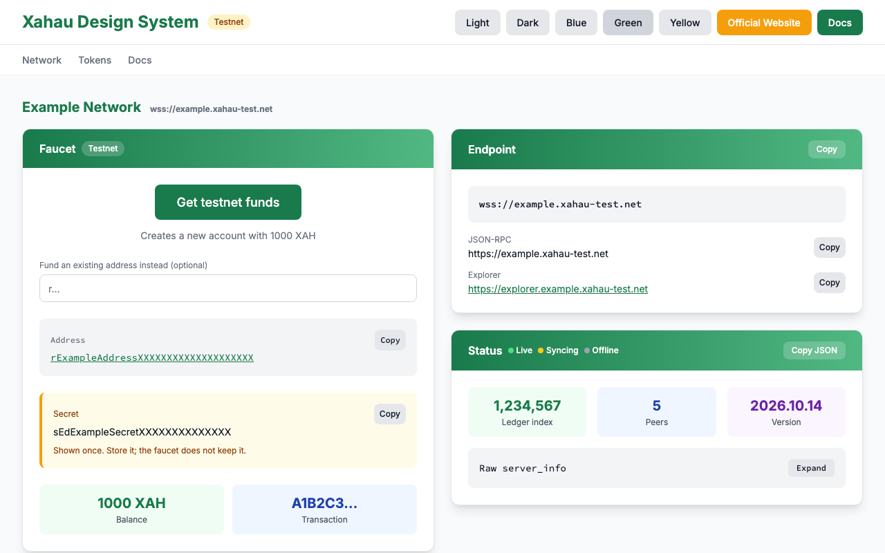
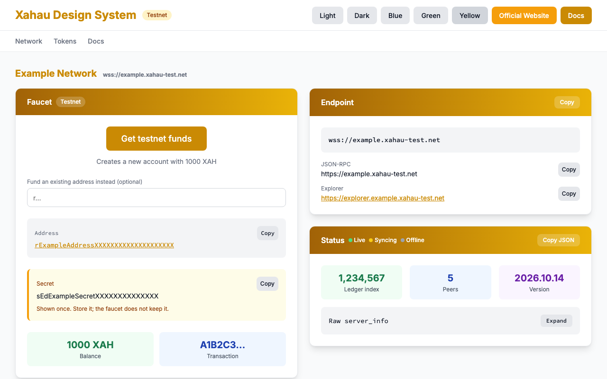
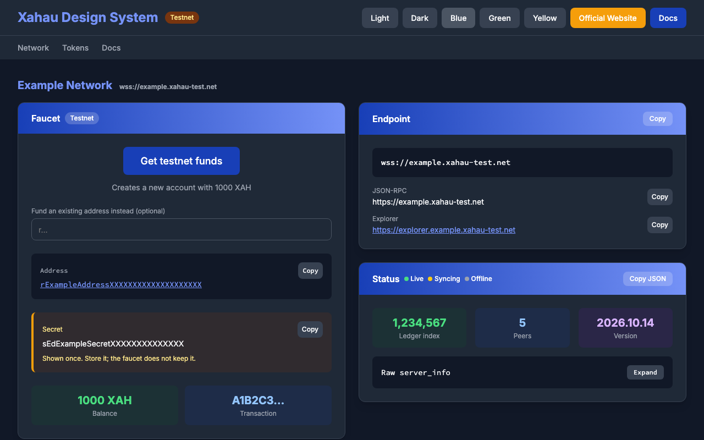

# Xahau Design System

A framework-free CSS design system for Xahau network tools. Plain CSS custom properties plus `x-` prefixed component classes, no build step, no dependencies. Open `index.html` for a living demo of every component in every theme.

| Blue (default)               | Green (`.theme-devnet`)        |
| ---------------------------- | ------------------------------ |
|  |  |

| Yellow (`.theme-yellow`)         | Dark (`.dark`)               |
| -------------------------------- | ---------------------------- |
|  |  |

## Sources

- xahau-test.net, the official testnet faucet by XRPL Labs. Its values are the primitives.
- xahau-dev.net, generated by [tequdev/xahau-network-generator](https://github.com/tequdev/xahau-network-generator). It is a theme override.

## Decisions

- Testnet blue (`#183FB7`, hover `#1d4ed8`, light `#7592F7`) is the default brand. Devnet green (`#197a4b`) is the `.theme-devnet` override and remaps only brand and gradient tokens. Yellow (`#ca8a04`, gradient `#a16207`→`#eab308`) is `.theme-yellow`, same shape; it has no source page and shares its hue with the warning button and badge.
- Gray scale and accents are the Tailwind palette used by testnet. The devnet page's Digital Agency token file is not vendored.
- Fonts are Inter and Source Code Pro (testnet), not devnet's Noto Sans Mono. Fonts are not imported by the CSS, link them in `<head>`; fallbacks are system fonts.
- Dark mode works via `.dark` on `<html>` (testnet style), `[data-theme="dark"]`, or the OS preference unless `[data-theme="light"]`/`.light` is set.
- Brand themes are classes (`.theme-devnet`, `.theme-yellow`), not `data-theme` values, so they compose with dark mode. Put them on `<html>`.
- Focus is a 2px brand outline, equivalent to testnet's ring.
- No icon font, since testnet's Font Awesome kit is tied to their account. Use inline SVG.
- The Hooks Builder purple `#9D2DFF` is a logo fill, not a token.

## Usage

```html
<link rel="stylesheet" href="https://fonts.googleapis.com/css2?family=Inter:wght@400;500;600;700&family=Source+Code+Pro:wght@400;500;700&display=swap">
<link rel="stylesheet" href="tokens.css">
<link rel="stylesheet" href="xahau.css">
<html class="dark theme-devnet"> <!-- both optional; or theme-yellow -->
```

## Components

- `x-container` centered page width with responsive gutters
- `x-topbar`, `x-topbar-row`, `x-brand`, `x-subnav` header with brand and secondary nav
- `x-card`, `x-card-head`, `x-card-sub`, `x-card-body` card with gradient header
- `x-btn` plus `-secondary`, `-warning`, `-glass`, `-sm`, `-lg`; `:disabled` is gray
- `x-badge`, `x-badge-glass` pill label
- `x-box` monospace inset block for addresses and URLs
- `x-tiles`, `x-tiles-2`, `x-tile`, `x-tile-green|blue|purple` stat tiles
- `x-dot`, `x-dot-live`, `x-dot-wait`, `x-state` status indicator
- `x-label`, `x-input` form field
- `x-callout-warn`, `x-callout-error` message blocks
- `x-endpoints`, `x-endpoint` label and value rows
- `x-details`, `x-summary` disclosure with Expand/Collapse chip
- `x-footer`, `x-grid`, `x-stack` layout helpers
